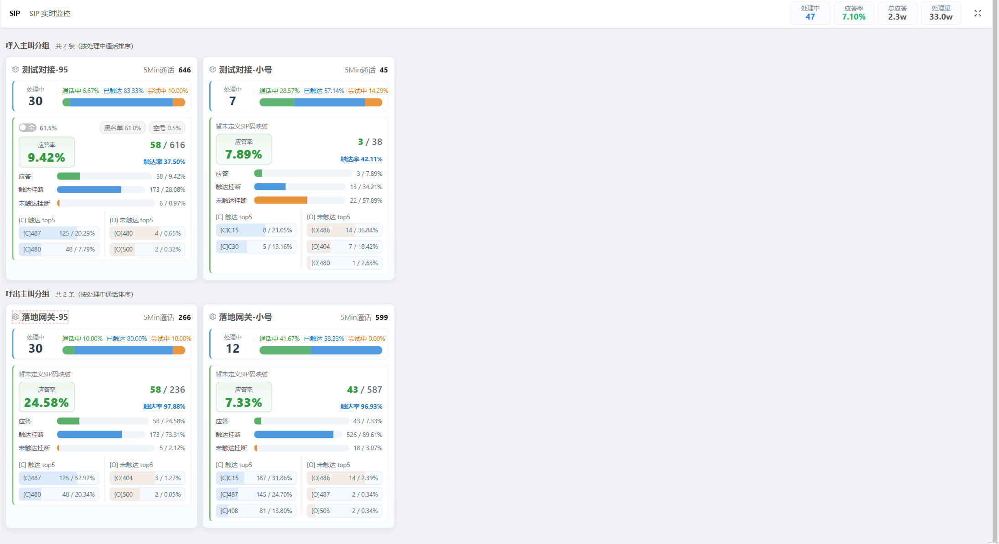

# SIPFW — SIP 实时监控

SIP 实时监控看板。后端抓取并解析 SIP 报文，按主叫分组统计呼入/呼出通话指标，
每几秒通过 WebSocket 推送给前端大屏页面实时渲染。

- **`gcs-flx/`** — Java 后端（Java 8 + Spring Boot 2.6 + Maven + PostgreSQL）
- **`wvflx-antd/`** — Vue 2 前端（Node 12 + Vue 2.6 + Ant Design Vue 1.6 + Yarn）

## 系统截图



## 工作原理

1. 后端启动后在应用就绪事件里拉起外部进程 **`sipgrep`** 抓取本机 SIP 报文
   （默认 `sipgrep -P5060-19999 -C -d any`）。
2. 解析 SIP 报文流，维护活跃通话 `SipCallSession`，按前缀定义分组统计。
3. 按固定间隔（默认 3s）把统计快照推送到 STOMP 主题 `/topic/sipfw`。
4. 前端 `SipfwPage` 订阅该主题，实时渲染各主叫分组的处理中/应答/触达等指标；
   页面上可点击卡片齿轮图标维护“分组前缀定义”（写入数据库）。

## 前置依赖

| 组件 | 说明 |
|------|------|
| JDK 8 | 后端编译运行 |
| Maven 3.6+ | 后端构建 |
| Node 12 | 前端构建（`yarn`） |
| PostgreSQL | 数据库，表由 Hibernate `ddl-auto: update` 自动创建 |
| **sipgrep** | 抓包工具，需安装在**能看到 SIP 报文的主机**上（通常是 SBC/PBX 主机），见 [安装 sipgrep](#安装-sipgrep抓包组件) |

> 抓包说明：`sipgrep` 基于 libpcap，`-d any` 为实时抓包，因此后端必须运行在
> SIP 流量可达的主机上（例如运行 FreeSWITCH/SBC 的那台机器）。无实时流量时看板
> 会显示“暂无数据”，不影响启动。

## 安装 sipgrep（抓包组件）

实时抓包依赖外部工具 [sipcapture/sipgrep](https://github.com/sipcapture/sipgrep)（GPL-3.0）。
发行版仓库里的版本往往陈旧或缺失（Debian 有较老的 `sipgrep` 包，RHEL/统信等通常没有），
**推荐直接从源码编译**最新的 2.x（依赖 `libpcap` + `libpcre2` 两个库）。

> **省事做法：交给 AI 编程助手编译。** 直接把仓库地址
> <https://github.com/sipcapture/sipgrep> 交给 Claude Code 等 Agent，让它按下面步骤
> 装依赖、`git clone` 并 `make install` 即可；也可让它顺带完成第 3 步的抓包权限配置。

### 1. 安装编译依赖

RHEL / CentOS / Rocky / 统信 UOS（`dnf` 或 `yum`）：

```bash
sudo dnf install -y gcc make autoconf automake libtool pkg-config git \
                    libpcap-devel pcre2-devel
```

Debian / Ubuntu：

```bash
sudo apt-get install -y build-essential autoconf automake libtool pkg-config git \
                        libpcap-dev libpcre2-dev
```

> 注意 configure 检测的是 **pcre2**（`pcre2.h` / `libpcre2-8`），别装成老的 pcre1。

### 2. 编译安装

```bash
git clone https://github.com/sipcapture/sipgrep.git
cd sipgrep
./configure          # 仓库已附带 configure；若缺失，先执行 ./build.sh 生成
make
sudo make install    # 默认安装到 /usr/local/bin/sipgrep
sipgrep -V           # 验证，输出：sipgrep: V2.01b
```

默认安装路径 `/usr/local/bin/sipgrep`，与配置项 `sip.analysis.sipgrep-path` 的默认值一致；
若装到其它位置，请同步修改 `gcs-flx/src/main/resources/yml_config/sip-analysis.yml` 中的 `sipgrep-path`。

### 3. 授予抓包权限

libpcap 抓包需要 `CAP_NET_RAW`。要么**以 root 运行后端**，要么给 sipgrep 可执行文件单独
授权（更安全，避免整个服务用 root 跑）：

```bash
sudo setcap cap_net_raw,cap_net_admin+eip /usr/local/bin/sipgrep
```

## 后端运行（gcs-flx）

```bash
cd gcs-flx
# 1) 准备 PostgreSQL，创建数据库（默认库名 sipfw）
createdb sipfw

# 2) 配置连接（二选一）
#    a. 环境变量：DB_URL / DB_USER / DB_PASSWORD
#    b. 修改 src/main/resources/application.yml
export DB_URL="jdbc:postgresql://localhost:5432/sipfw"
export DB_USER=postgres
export DB_PASSWORD=postgres

# 3) 生产环境务必配置 JWT 签名密钥（默认占位符 change-me）
export GCS_JWT_SECRET="your-jwt-secret"

# 4) 启动（默认 profile dev；生产用 prod）
#    两个 profile 默认都开启 SIP 抓取（sip.analysis.enabled=true），
#    因此运行前请先安装好 sipgrep（见上一节）；
#    本机不做抓包时可把该开关改为 false，看板仍可展示已入库数据。
mvn spring-boot:run -Dspring-boot.run.profiles=prod
# 或： ./run.sh
```

- 端口 **18087**，上下文路径 `/gcs-flx`。
- 首次启动会自动建表、初始化序列、组织结构，并播种元视图（菜单/页面）。
- 默认管理员账号 **admin**，初始密码取环境变量 `GCS_ADMIN_PASSWORD`（未设置时为 `admin123`）。

## 前端运行（wvflx-antd）

```bash
cd wvflx-antd
yarn install
yarn serve        # 开发服务器，端口 3001，代理 /gcs-flx -> http://localhost:18087
yarn build        # 生产构建，产物在 dist/
```

登录后进入 **SIP监控** 菜单即可查看看板。

## 呼叫方向判定（local-ip-regex-list）

**呼叫方向（呼入 / 呼出）由「本机 IP 正则列表」判定**，即 `sip.analysis.local-ip-regex-list`：

- SIP 报文的**源 IP** 命中本机 → **呼出（OUTBOUND）**（通话由本机发起）；
- SIP 报文的**目的 IP** 命中本机 → **呼入（INBOUND）**（通话打给本机）；
- 两者都不命中 → `UNKNOWN`（不计入分组统计）。

也就是说，这个列表要填 **运行 `sipgrep` 的那台机器自身的 IP**（正则，可多条）；
一条都没配时回退为回环 `127\.0\.0\.\d{1,3}`。

它按 profile 配置，已在 `application-dev.yml` / `application-prod.yml` 中配置（默认仅回环），
部署时按实际网段追加即可：

```yaml
sip:
  analysis:
    local-ip-regex-list:
      - 127\.0\.0\.\d{1,3}    # 默认：本机回环
      - 10\.0\.0\.\d{1,3}     # 示例：部署主机所在网段，按实际替换（此行默认无，需自行添加）
```

## 配置项

| 环境变量 | 说明 |
|----------|------|
| `DB_URL` / `DB_USER` / `DB_PASSWORD` | 数据库连接 |
| `GCS_JWT_SECRET` | JWT 签名密钥（生产必填） |
| `GCS_ADMIN_PASSWORD` | 首次初始化时的管理员密码 |
| `MAIL_HOST` / `MAIL_PORT` / `MAIL_USERNAME` / `MAIL_PASSWORD` / `MAIL_FROM` | 邮件发送（可选） |

SIP 抓取参数在 `gcs-flx/src/main/resources/yml_config/sip-analysis.yml`
（`sipgrep-path`、`port-range` 等）；其中 `local-ip-regex-list`（呼叫方向判定）在
`application-dev.yml` / `application-prod.yml` 里按环境配置（见上一节）。

## 目录结构

```
sipfw/
├─ gcs-flx/                 # 后端：gcs.base / gcs.modules / gcs.app.{sipfw,ugrp,vm}
│  └─ src/main/java/gcs/app/sipfw/   # 实时分析引擎
├─ wvflx-antd/              # 前端
│  └─ src/views_app/other/page_ot_sipfw/  # 看板页面
├─ docs/images/             # README 配图（系统截图、微信二维码）
└─ LICENSE                  # GPL-3.0
```

## 联系作者

微信扫码，添加我为好友：


## 许可证

[GPL-3.0](LICENSE)
